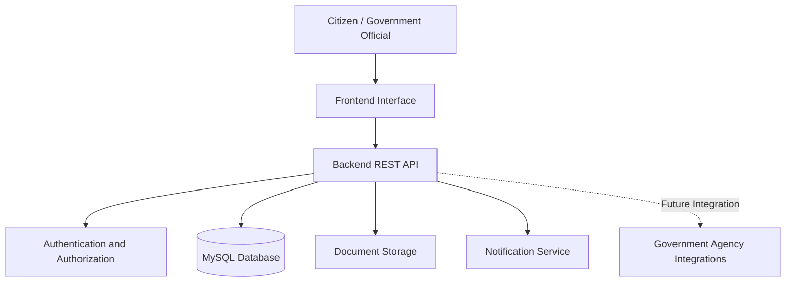
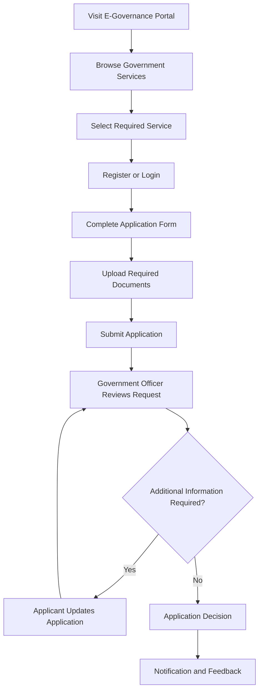

# E-Governance and Digital Services Portal

**A proposed citizen-centred platform for accessing, requesting, and tracking government services online.**

**Project Type:** Software Development Internship Project  
**Current Phase:** Requirements Analysis and UI/UX Design  
**Repository:** https://github.com/12samuel12/e-governance-digital-services

## Project Overview

The E-Governance and Digital Services Portal is a proposed web-based application designed to improve the delivery of government services through digital technology.

The platform aims to provide citizens with a centralized system where they can access government information, submit service applications, upload documents, track application progress, receive notifications, and communicate with government agencies.

The project addresses common challenges associated with traditional government service delivery, including long queues, excessive paperwork, delays in processing applications, limited transparency, and difficulties accessing public services.

The goal is to develop a secure, accessible, responsive, and user-friendly platform that improves communication and service delivery between citizens and government institutions.

This project is being developed progressively, beginning with system planning, requirements specification, UI/UX design, and prototyping.

## Problem Statement

Traditional government service delivery often requires citizens to visit multiple offices, complete physical forms, and wait for long periods without receiving clear updates about their applications.

These challenges can result in wasted time, increased expenses, inefficient processing, and reduced public satisfaction.

The proposed E-Governance platform seeks to address these problems by providing a digital environment where government services can be accessed and managed more efficiently.

## Project Objectives

- Improve accessibility to government services.
- Reduce paperwork and manual processing.
- Provide a centralized digital service platform.
- Allow citizens to submit applications online.
- Enable transparent application tracking.
- Improve communication between citizens and government agencies.
- Support secure management of citizen information.
- Provide feedback and complaint management.
- Improve efficiency and accountability in government operations.
- Ensure accessibility across desktop and mobile devices.

## Target Users

The proposed application is designed for different categories of users.

### 1. Citizens

Citizens will be able to:
- Create accounts and log in securely.
- Browse available government services.
- Submit service applications.
- Upload supporting documents.
- Track application progress.
- Receive notifications.
- Submit feedback and complaints.

### 2. Government Officials

Government officials will be able to:
- Review submitted applications.
- Verify application information.
- Request additional documents.
- Update application statuses.
- Process assigned service requests.
- Communicate application decisions.

### 3. Agency Supervisors

Supervisors will be able to:
- Monitor application processing.
- Assign requests to officers.
- Review service performance.
- Manage escalated applications.
- Generate operational reports.

### 4. System Administrators

Administrators will be responsible for:
- Managing authorized user accounts.
- Configuring government services.
- Managing roles and permissions.
- Monitoring system activities.
- Maintaining platform security.

## Proposed Government Services

The platform is designed to support different government service categories, including:

- Civil registration and certificate requests
- Business registration-related services
- Government permits and licences
- Tax and revenue enquiries
- Public service appointments
- Document verification requests
- Public complaints and feedback
- Government information and announcements

These are proposed service categories. They are not currently connected to live government agencies.

## Key Features

### User Authentication
Secure account registration, login, password recovery, and role-based access control.

### Service Directory
A searchable directory where citizens can browse available government services and view their requirements.

### Online Service Applications
Digital forms that allow citizens to submit requests and upload supporting documents.

### Citizen Dashboard
A personalized dashboard displaying submitted applications, notifications, and recent activities.

### Application Tracking
A tracking system that allows users to monitor the progress of their submitted requests.

### Notification System
Notifications for application submissions, status updates, document requests, and service decisions.

### Feedback and Complaints
A platform where citizens can report issues, submit complaints, and provide suggestions.

### Government Administration
Administrative tools for reviewing applications, managing users, updating services, and generating reports.

## UI/UX Design

The application is designed with a focus on simplicity, accessibility, responsiveness, and ease of navigation.

### Designed Pages

1. **Homepage**
   - Main navigation
   - Service search
   - Featured government services
   - Login and registration access

2. **Service Directory**
   - Government service categories
   - Search and filtering
   - Service descriptions
   - Application requirements

3. **Service Request Form**
   - Application fields
   - Document uploads
   - Form validation
   - Submission controls

4. **Citizen Dashboard**
   - Application overview
   - Recent requests
   - Notifications
   - Quick access to services

5. **Application Tracking**
   - Application reference number
   - Current application status
   - Processing timeline
   - Required next actions

6. **Help and Feedback**
   - Frequently asked questions
   - Support information
   - Feedback submission
   - Complaint management

The current designs are static wireframes illustrating the proposed interface and user experience.

## Proposed Technology Stack

### Frontend
- HTML5
- CSS3
- JavaScript

### Backend
- Node.js
- Express.js

### Database
- MySQL

### Development and Design Tools
- Visual Studio Code
- Git
- GitHub
- UI/UX wireframes
- Microsoft Word

**Note:** These technologies represent the proposed implementation architecture. The complete application has not yet been developed.

## System Architecture

The proposed application follows a client-server architecture.



### Architecture Description

**Frontend:** Provides the interface through which users interact with the platform.

**Backend:** Handles application logic, API requests, authentication, and service processing.

**Database:** Stores user accounts, applications, service information, and application records.

**Authentication:** Controls user access and permissions.

**Document Storage:** Manages supporting files submitted by applicants.

**Notification Service:** Provides updates about application activities.

## Service Application Workflow



## Internship Tasks and Deliverables

### Task 1: Project Planning and Requirements Specification

This stage focuses on defining the objectives, scope, requirements, and technical structure of the proposed application.

**Completed Deliverables:**
- Project planning document
- Problem statement and objectives
- Target user analysis
- Functional requirements
- Non-functional requirements
- System architecture
- User roles and permissions
- Service workflows
- Security considerations
- Implementation planning

**Document:**

[View Task 1 - Planning and Requirements](./E_Governance_Planning_and_Requirements_Specification.docx)

### Task 2: UI/UX Design and Prototyping

This stage focuses on designing a user-friendly and accessible interface for the application.

**Completed Deliverables:**
- Homepage wireframe
- Service directory wireframe
- Service request form wireframe
- Citizen dashboard wireframe
- Application tracking wireframe
- Help and feedback wireframe
- UI/UX design documentation
- Navigation flow explanations
- Design annotations
- Accessibility considerations

**Document:**

[View Task 2 - UI/UX Wireframes and Prototypes](./E_Governance_UI_UX_Wireframes_and_Prototypes.docx)

## Repository Structure

```text
e-governance-digital-services/
│
├── README.md
│
├── E_Governance_Planning_and_Requirements_Specification.docx
│
└── E_Governance_UI_UX_Wireframes_and_Prototypes.docx
```

Additional folders will be introduced as development progresses.

## Project Progress

- [x] Project planning and requirements specification
- [x] System architecture design
- [x] User roles and workflow documentation
- [x] UI/UX design documentation
- [x] Six conceptual wireframes
- [ ] Interactive prototype
- [ ] Frontend development
- [ ] Backend API development
- [ ] Database integration
- [ ] Authentication implementation
- [ ] Application testing
- [ ] Deployment

## Security and Accessibility

The proposed application will consider:

- Secure user authentication
- Role-based access control
- Password hashing
- Input validation
- Secure document uploads
- Data protection and privacy
- HTTPS communication
- Responsive layouts
- Keyboard accessibility
- Clear form labels and error messages
- Readable typography and sufficient color contrast

## Future Development Plans

The next development stages will include:

1. Building the responsive frontend interface.
2. Implementing registration and login functionality.
3. Developing the backend REST API.
4. Creating and integrating the MySQL database.
5. Implementing service request processing.
6. Adding application tracking and notifications.
7. Developing administrative dashboards.
8. Performing security and usability testing.
9. Deploying the completed application.

## Expected Impact

The proposed E-Governance platform aims to improve public service delivery by reducing unnecessary physical visits, simplifying service requests, improving transparency, and providing citizens with convenient access to government information.

It also aims to support government institutions through improved application management, accountability, and digital record keeping.

## Project Status

**Current Stage:** Planning and UI/UX Design

The project currently includes requirements documentation, conceptual system architecture, workflow diagrams, and six UI/UX wireframes.

The functional web application remains a future development stage.

## Author

**GitHub:** [12samuel12](https://github.com/12samuel12)

**Repository:** [E-Governance and Digital Services](https://github.com/12samuel12/e-governance-digital-services)

**Project Type:** Software Development Internship Project

---

**Disclaimer:** This is an educational software development project. It is not an official government portal and is not affiliated with any government agency.
